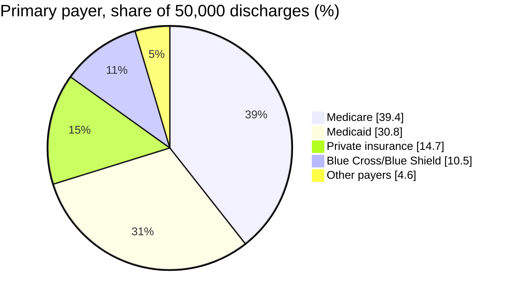
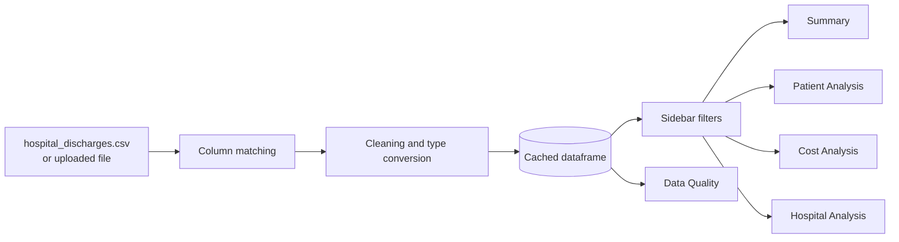

<p align="center">
  
</p>

<p align="center">
  <a href="https://YOUR-APP-NAME.streamlit.app"></a>
</p>

<p align="center">
  
  
  
  
  
  
</p>

<p align="center">
  Sri Prasath.P &nbsp;|&nbsp; Registration number 1000408 &nbsp;|&nbsp; CRS: Artificial Intelligence<br>
  Mathematics for AI-II &nbsp;|&nbsp; Jain Vidyalaya IB World School
</p>

---

## Project overview

MediScope Health Analytics works with hospitals to improve patient care and operations. This dashboard helps hospital administrators, clinicians and operations managers see where stays run long, where charges climb and how hospitals and counties differ.

The data is the New York State SPARCS de-identified inpatient discharge file for 2021. The repository holds a 50,000-row sample (33 columns, 202 facilities, 57 counties), which keeps it well under GitHub's 100 MB file limit. A full-size CSV or Excel file with the same columns can be uploaded from the app sidebar.

<p align="center">
  
</p>

## What the data says

<p align="center">
  
</p>

Charges rise 6 times from Minor to Extreme severity ($36K to $219K), and the average stay grows from 2.9 to 14.7 days. Length of stay and total charges have a Pearson correlation of 0.69 in this sample. These are associations, not proof of cause and effect.



## Research questions

| # | Question | Where to find it |
|---|---|---|
| 1 | Which diagnoses are linked to the longest stays? | Patient Analysis |
| 2 | How do charges vary by age group and gender? | Patient Analysis, Cost Analysis |
| 3 | How do severity, charges and length of stay relate? | Cost Analysis |
| 4 | Which hospitals and counties have the longest average stay? | Hospital Analysis |
| 5 | How do payment types differ in volume and charges? | Cost Analysis |

## Dashboard pages

| Page | What it shows |
|---|---|
| Summary | KPI cards, admission types, gender split, length-of-stay histogram, severity counts, filtered CSV download |
| Patient Analysis | Age, gender, race and ethnicity counts; average stay by diagnosis; charges by age group and gender |
| Cost Analysis | Box plot of charges by severity, average charges and total costs by severity, stay by severity, stay vs charges scatter, charges vs costs by age group, stay and share of discharges by mortality risk, payment type pie chart and average charges by payer |
| Hospital Analysis | Facility by county heatmap of average stay, top 10 hospitals by volume, counties with the longest stay, hospital summary table, diagnosis view for one facility |
| Data Quality | Row, column, missing value and duplicate counts, cleaning notes, numeric summary, cleaned data preview and download |

The five visuals required by the brief:

| Required visual | Chart in the app |
|---|---|
| Bar chart | Average stay per diagnosis (Patient Analysis) |
| Box plot | Total charges by severity (Cost Analysis) |
| Heatmap | Average stay by facility and county (Hospital Analysis) |
| Pie chart | Discharges by primary payment type (Cost Analysis) |
| Histogram | Length of stay distribution (Summary) |

## Key features

- Sidebar filters for year, county, facility, age group, gender, severity, admission type and payment type, with a Clear Filters button.
- Interactive Plotly charts with hover details.
- Upload your own CSV or Excel file, or change the currency symbol.
- A short reading note under every chart. Hospital figures are described as activity, not quality.

## How the app is wired



<details>
<summary><b>Data cleaning steps</b></summary>

- Column names are matched against a fixed list, so small naming differences in the file still load.
- Charges and costs are converted from text to numbers.
- Negative or unreadable lengths of stay are set to missing. Top-coded stays such as "120+" are counted at the number shown and flagged.
- Age groups, gender, severity and other categories are standardised. Age groups and severity keep their natural order.
- Birth Weight is dropped when fewer than half the records have a usable value (9.9% here).
- Blank categories become "Unknown". Exact duplicate rows are counted and kept unless the sidebar option is ticked.
- Extreme charges (above Q3 + 3 x IQR) are flagged, not deleted. The Cost Analysis page can hide them from the box plot and scatter plot only.
- Facility IDs, certificate numbers and ZIP prefixes are hidden from previews and downloads.

</details>

## Integration details

| Part | Tool |
|---|---|
| Data handling | pandas, NumPy |
| Charts | Plotly (Express and Graph Objects) |
| App framework | Streamlit |
| Excel input | openpyxl |
| Version control | GitHub |
| Hosting | Streamlit Community Cloud |

```
app.py                   main dashboard code
requirements.txt         dependency ranges
hospital_discharges.csv  sample dataset (50,000 rows)
assets/                  animated graphics used in this README
.streamlit/config.toml   theme and upload size
.gitignore
README.md
```

`app.py` loads `hospital_discharges.csv` from its own folder. If the file is missing it shows a welcome screen and asks for an upload. Cleaning results are cached with `st.cache_data`, so changing a filter does not reload the file.

## Deployment instructions

Run locally:

```bash
pip install -r requirements.txt
streamlit run app.py
```

Deploy on Streamlit Community Cloud:

1. Push every file in the layout above to a public GitHub repository.
2. Open [share.streamlit.io](https://share.streamlit.io) and sign in with GitHub.
3. Click Deploy an app, then pick the repository and branch.
4. Set the main file path to `app.py` and click Deploy.
5. Copy the app link into the Live app badge at the top of this README.

## Screenshots

Add one screenshot per page here, for example ``.

## Limits

- The dashboard describes patterns in the data. It does not show cause and effect, and it is not a clinical diagnosis tool.
- The sample covers one discharge year, so no yearly trend is shown.
- Hospital averages depend on case mix and specialisation, so they should not be used to rank hospital quality.
